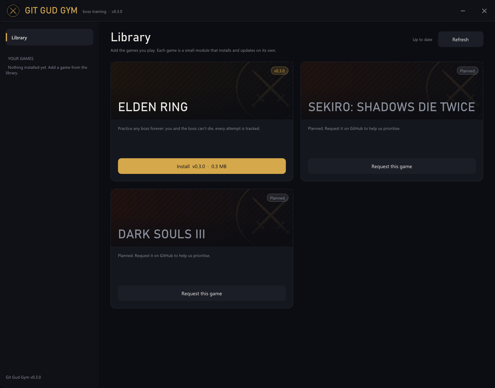

<div align="center">


# Git Gud Gym

**Endless boss practice for souls-likes.** Neither you nor the boss can die. You keep fighting,
learn the moveset, and every attempt is logged so you can watch yourself improve.

Install Git Gud Gym once, then add the games you play from its library.

[](https://github.com/Git-Gud-Gym/git-gud-gym/releases/latest)
[](https://github.com/Git-Gud-Gym/git-gud-gym/releases)
[](https://github.com/Git-Gud-Gym/git-gud-gym/actions/workflows/build.yml)

[](https://git-gud-gym.github.io/git-gud-gym/)


[](LICENSE)
[](CONTRIBUTING.md)


<sub>A game page mid-fight (sample data).</sub>

</div>

---

## Games

| Game | Module | Tested on | Status |
|---|---|---|---|
| Elden Ring | `eldenring` | patch 1.12.0 | ✅ Available |
| Sekiro: Shadows Die Twice | | | 🗓️ Planned |
| Dark Souls III | | | 🗓️ Planned |

Want another game? [Request it](https://github.com/Git-Gud-Gym/git-gud-gym/issues/new?template=game_request.yml),
or [build the module yourself](docs/ADDING_A_GAME.md).

## Features

| | |
|---|---|
| **Can't die** | Lethal hits refill your HP instead of killing you, and count as a death. |
| **Boss can't die either** | At zero HP the boss refills to full, and it counts as a defeat. Phase changes triggered by HP thresholds still happen. |
| **Falls count** | Fall off a ledge and you're put back on the last solid ground you stood on. |
| **Stats** | Damage dealt and taken, hits, healing, lowest boss HP, attempt times, fastest defeat. Saved as CSV after every attempt. |
| **In-game notifications** | "YOU DIED" / "BOSS DEFEATED" pop-ups and a mini HUD over the game, with optional sounds. |
| **Game library** | Install, update and remove game modules in one click. Every download is checksum-verified. |
| **Finds your games** | Searches your Steam libraries and common folders, or you can browse to the exe. |
| **Hotkeys** | Everything important works from inside the game with F5 to F10. |

## Quick start

1. **Download** `GitGudGym-v*.zip` from the
   [latest release](https://github.com/Git-Gud-Gym/git-gud-gym/releases/latest), extract it anywhere,
   and run `GitGudGym.exe`. Accept the administrator prompt: the app needs it to launch the game and
   attach to it.
2. **Install a game** from the **Library**.
3. **Click Launch game** on the game's page. The app finds your install and starts the game offline,
   without anti-cheat. Once the game has loaded, the mod attaches and the status turns **Active**.
4. **Walk into a boss arena** and fight.

<p align="center"></p>

> [!IMPORTANT]
> Git Gud Gym is for **offline, single-player** practice. The app refuses to attach while a game's
> anti-cheat is running. Modding a game online can get your account flagged.

### Playing offline without anti-cheat (Steam)

For Steam copies, **Launch game** offers to create `steam_appid.txt` in the game folder. That file
lets the game start directly, offline, instead of relaunching through Steam with anti-cheat. To play
online again, delete it and use Steam's Play button.

> [!TIP]
> On-screen notifications and the HUD need **Borderless** or **Windowed** display mode.

## Controls

| Key | In game | App |
|-----|---------|-----|
| <kbd>F5</kbd> | Immortality on / off (you and the boss) | *Player can't die* / *Boss can't die* |
| <kbd>F6</kbd> | Track the next boss candidate | *Next boss* |
| <kbd>F7</kbd> | Let the boss die once (for phase changes triggered by a scripted death) | *Let boss die once* |
| <kbd>F8</kbd> | Probe: write diagnostics to the log | *Probe* |
| <kbd>F9</kbd> | Save the session and start a new one | *New session* |
| <kbd>F10</kbd> | Unload the mod | *Unload mod* |

## Your stats

Each game keeps its stats in `%LOCALAPPDATA%\GitGudGym\data\<game>\stats\`. Use **Stats folder** on
the game page to open it. Open the files in Excel, Google Sheets, or anything that reads CSV.

**`attempts.csv`**, one row per attempt:

| Column | Meaning |
|---|---|
| `outcome` | `death`, `fall`, `defeat`, or `abandoned` |
| `duration_s` | Fight length in seconds |
| `damage_dealt` / `damage_taken` | HP removed from the boss / from you |
| `hits_landed` / `hits_taken` | Number of hits |
| `healing` | HP you healed during the attempt |
| `boss_lowest_hp_pct` | How close you got: 0 means a defeat |
| `session_id`, `label` | Groups attempts. Set `session_label` in the module's ini to tag them. |

**`sessions.csv`**, one row per session: totals, fastest defeat, average attempt length, and the
best boss HP % you reached.

## How it works

```
GitGudGym.exe (hub)  <── shared memory ──>  gitgudgym-<game>.dll (inside the game)
  library, stats UI, overlay, sounds          shared trainer core + one adapter per game
```

Each game module is a small DLL: the shared trainer core plus a **game adapter** that knows where
that game keeps player HP, enemies and positions. The hub downloads modules from this repo's
releases, verifies them, and loads the right one into the game. Details are in
[docs/ARCHITECTURE.md](docs/ARCHITECTURE.md).

## Contributing

New games are the most valuable contribution. A module is one folder and one class; see
[docs/ADDING_A_GAME.md](docs/ADDING_A_GAME.md). For everything else (building, PRs, releases),
see [CONTRIBUTING.md](CONTRIBUTING.md).

```bat
git clone https://github.com/Git-Gud-Gym/git-gud-gym.git
cd git-gud-gym
build.bat
```

## Roadmap

- [ ] **True phase 1 reset:** reload the encounter on a boss defeat instead of only refilling HP
- [ ] Boss names in stats instead of max HP
- [ ] Support for the latest Elden Ring patch
- [ ] Progress charts from the CSV history
- [ ] More games: Sekiro, Dark Souls III, and whatever the community asks for

## Known limitations

- **No phase 1 reset:** a boss defeat refills HP but doesn't reset the boss to phase 1.
- **Instant-death effects:** these may bypass immortality.
- **Damage credit:** damage from spirit ashes and co-op summons counts as yours.

## Credits

- [Dear ImGui](https://github.com/ocornut/imgui) by Omar Cornut (MIT): the app's UI
- [JSON for Modern C++](https://github.com/nlohmann/json) by Niels Lohmann (MIT)
- Notification sound: "Gaming lock" from [Mixkit](https://mixkit.co/free-sound-effects/), under the Mixkit Sound Effects Free License
- Fonts: Segoe UI and Bahnschrift, loaded from Windows

Claude (Anthropic) was used as a development assistant throughout this project, helping with implementation, debugging, and technical research.

## License

[MIT](LICENSE). Git Gud Gym is a fan-made tool and isn't affiliated with or endorsed by FromSoftware,
Bandai Namco or any other publisher. Game names are trademarks of their respective owners. Use it
offline, at your own risk.
