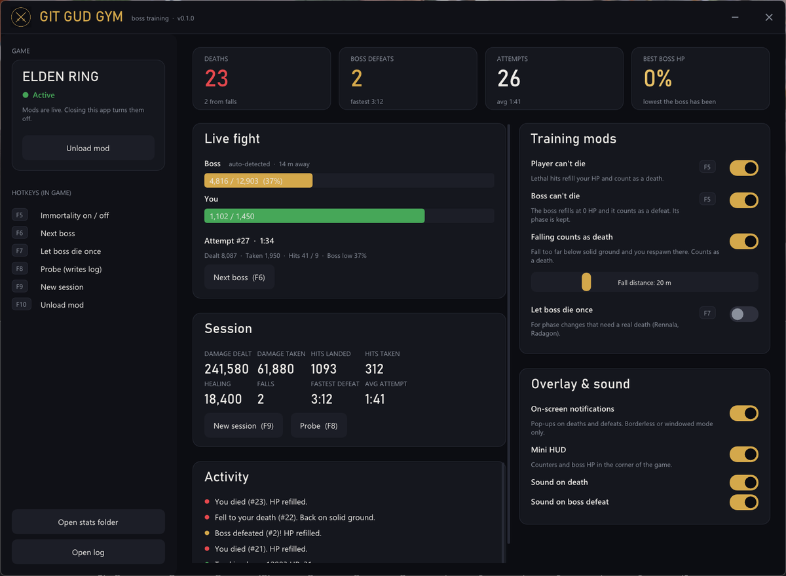

<div align="center">


# Git Gud Gym

**Endless boss practice for souls-likes.** Neither you nor the boss can die. You keep fighting,
learn the moveset, and every attempt is logged so you can watch yourself improve.

[](https://github.com/ryyanrashid01/git-gud-gym/releases/latest)
[](https://github.com/ryyanrashid01/git-gud-gym/releases)
[](https://github.com/ryyanrashid01/git-gud-gym/actions/workflows/build.yml)


[](LICENSE)



<sub>The app mid-fight (sample data).</sub>

</div>

---

## Features

| | |
|---|---|
| **Can't die** | Lethal hits refill your HP instead of killing you, and count as a death. |
| **Boss can't die either** | At zero HP the boss refills to full, and it counts as a defeat. Phase changes triggered by HP thresholds still happen. |
| **Falls count** | Fall off a ledge and you're put back on the last solid ground you stood on, so you're never stuck at the bottom of a cliff. |
| **Stats** | Damage dealt and taken, hits landed and taken, healing, lowest boss HP, attempt times, fastest defeat. Saved as CSV after every attempt. |
| **In-game notifications** | "YOU DIED" / "BOSS DEFEATED" pop-ups and a mini HUD drawn over the game, with optional sounds. |
| **Desktop app** | Live HP bars, session stats, activity feed and toggles. It attaches to the game for you and detaches when closed. |
| **Hotkeys** | Everything important works from inside the game with F5 to F10. |

## Quick start

1. **Download** `GitGudGym-EldenRing-v*.zip` from the
   [latest release](https://github.com/ryyanrashid01/git-gud-gym/releases/latest) and extract it anywhere.
2. **Run `GitGudGym.exe`** and accept the administrator prompt. The app needs admin rights to attach
   to the game and to launch it.
3. **Click Launch game.** The app finds your Elden Ring install by itself (see
   [Finding the game](#finding-the-game)) and starts it offline, without Easy Anti-Cheat. Once the game
   has loaded, the mod attaches automatically and the game card turns **Active**.
4. **Walk into a boss arena** and fight. The boss shows up under *Live fight*.

> [!IMPORTANT]
> Use Git Gud Gym **offline only**. The app refuses to attach while Easy Anti-Cheat is running.
> Modding the game online can get your account flagged.

### Finding the game

On start, the app looks for `eldenring.exe` in these places, in order:

- every Steam library listed in Steam's settings, including libraries on other drives
- the folder Steam's uninstaller records for Elden Ring
- common folders on every drive, such as `X:\SteamLibrary`, `X:\Games\ELDEN RING` and `Program Files`

The location shows in the sidebar under **Game location**. If it's wrong or missing, click
**Browse…** and pick `eldenring.exe` inside the game's `Game` folder. Starting the game yourself
also works: the app remembers wherever it sees the game running.

### Running Elden Ring without Easy Anti-Cheat (Steam)

**Launch game** handles this for you. The first time, it asks before creating `steam_appid.txt`
(containing `1245620`) in the game folder. That file lets `eldenring.exe` start directly, offline,
instead of relaunching through Steam with anti-cheat.

To do it by hand:
1. Create the file in the game folder.
2. With Steam running, start `eldenring.exe` directly. Don't use Steam's Play button.

To play online again, delete `steam_appid.txt` and use Steam's Play button.

> [!TIP]
> On-screen notifications and the HUD need **Borderless** or **Windowed** display mode. Exclusive
> fullscreen draws over them.

## Controls

| Key | In game | App |
|-----|---------|-----|
| <kbd>F5</kbd> | Immortality on / off (you and the boss) | *Player can't die* / *Boss can't die* |
| <kbd>F6</kbd> | Track the next boss candidate | *Next boss* |
| <kbd>F7</kbd> | Let the boss die once (for phase changes triggered by a scripted death) | *Let boss die once* |
| <kbd>F8</kbd> | Probe: write addresses, position and nearby enemies to `gitgudgym.log` | *Probe* |
| <kbd>F9</kbd> | Save the session and start a new one | *New session* |
| <kbd>F10</kbd> | Unload the mod | *Unload mod* |

Bosses that "die" to change phase (Rennala, Radagon into the Elden Beast) stay stuck at 1 HP unless
you press <kbd>F7</kbd> first. That lets them die once so the next phase can start.

## Your stats

Every attempt is saved in `stats\` next to `GitGudGym.exe`. Open them in Excel, Google Sheets, or
anything that reads CSV.

An attempt starts on the first hit and ends with your death, the boss's defeat, or you leaving.

**`attempts.csv`**, one row per attempt:

| Column | Meaning |
|---|---|
| `outcome` | `death`, `fall`, `defeat`, or `abandoned` |
| `duration_s` | Fight length in seconds |
| `damage_dealt` / `damage_taken` | HP removed from the boss / from you |
| `hits_landed` / `hits_taken` | Number of hits |
| `healing` | HP you healed during the attempt |
| `boss_lowest_hp_pct` | How close you got: 0 means a defeat |
| `session_id`, `label` | Groups attempts. Set `session_label` in `gitgudgym.ini` to tag them, e.g. `Malenia, bleed build` |

**`sessions.csv`**, one row per session: totals, fastest defeat, average attempt length, and the
best boss HP % you reached.

## Compatibility

| Elden Ring patch | `eldenring.exe` | Status |
|---|---|---|
| 1.12.0 | 2.2.0.0 | ✅ Tested |
| Other patches | | ⚠️ Untested. The app shows a warning. |

The mod finds game data by pattern-scanning the exe instead of using fixed addresses, so other
patches may work. If yours doesn't, press <kbd>F8</kbd> in game and
[open an issue](https://github.com/ryyanrashid01/git-gud-gym/issues) with your `gitgudgym.log`. The
offsets can also be changed in `gitgudgym.ini` without rebuilding.

## How it works

```
GitGudGym.exe (app)  <── shared memory ──>  gitgudgym.dll (inside eldenring.exe)
  toggles, stats UI, overlay, sounds          reads and writes character HP every 2 ms
```

- **Immortality:** the mod sets the game's per-character "no death" flag on you and the boss, so HP
  stops at 1. The mod sees the 1 HP, counts a death or defeat, and refills HP to full.
- **Falls:** the mod remembers the last spot where you stood level for half a second. If you drop
  more than the fall distance below it, or land hard enough to die below it, you're put back there.
- **Boss detection:** the enemy with the highest max HP within 80 m. Between attempts it keeps
  re-checking so it switches to the arena's boss as you walk in. During a fight it stays locked.
- **Safety:** reads are fault-tolerant, so a bad pointer is skipped instead of crashing the game.
  Unloading the mod clears every flag it set.

## Building from source

Requires Visual Studio 2022 (or Build Tools) with the C++ workload, which includes CMake.

```bat
git clone https://github.com/ryyanrashid01/git-gud-gym.git
cd git-gud-gym
build.bat
```

Binaries land in `bin\`. Dear ImGui is vendored in `third_party/`, so there's nothing else to install.

| Path | What's there |
|---|---|
| `src/mod/` | The in-game mod: memory access, immortality, falls, boss tracking, stats |
| `src/app/` | The desktop app: UI (Dear ImGui + D3D11), attaching, overlay (GDI+) |
| `src/common/` | The shared-memory contract between the two, and version info |
| `config/gitgudgym.ini` | Default settings and memory offsets |

### Releasing

1. Bump `project(GitGudGym VERSION x.y.z)` in `CMakeLists.txt`.
2. Add a `## Elden Ring vx.y.z` section to [`CHANGELOG.md`](CHANGELOG.md).
3. Tag and push: `git tag eldenring-vx.y.z && git push origin eldenring-vx.y.z`.

GitHub Actions builds, packages and publishes the release, using the changelog section as the notes.

## Roadmap

- [ ] **True phase 1 reset:** reload the encounter on a boss defeat instead of only refilling HP
- [ ] Boss names in stats instead of max HP
- [ ] Support for the latest Elden Ring patch
- [ ] Progress charts from the CSV history
- [ ] More games (Sekiro, Dark Souls III, ...). Each game gets its own download and its own
  `<game>-v*` releases, so you only download what you play.

## Known limitations

- **No phase 1 reset:** a boss defeat refills HP but doesn't reset the boss to phase 1 (see Roadmap).
- **Instant-death effects:** Deathblight and similar effects may bypass immortality.
- **Damage credit:** damage from spirit ashes and co-op summons counts as yours.

## Credits

- [Dear ImGui](https://github.com/ocornut/imgui) by Omar Cornut (MIT): the app's UI
- Notification sound: "Gaming lock" from [Mixkit](https://mixkit.co/free-sound-effects/), under the Mixkit Sound Effects Free License
- Fonts: Segoe UI and Bahnschrift, loaded from Windows

Claude (Anthropic) was used as a development assistant throughout this project, helping with implementation, debugging, and technical research.

## License

[MIT](LICENSE). Git Gud Gym is a fan-made tool and isn't affiliated with or endorsed by FromSoftware or
Bandai Namco. ELDEN RING is a trademark of its respective owners. Use it offline, at your own risk.
